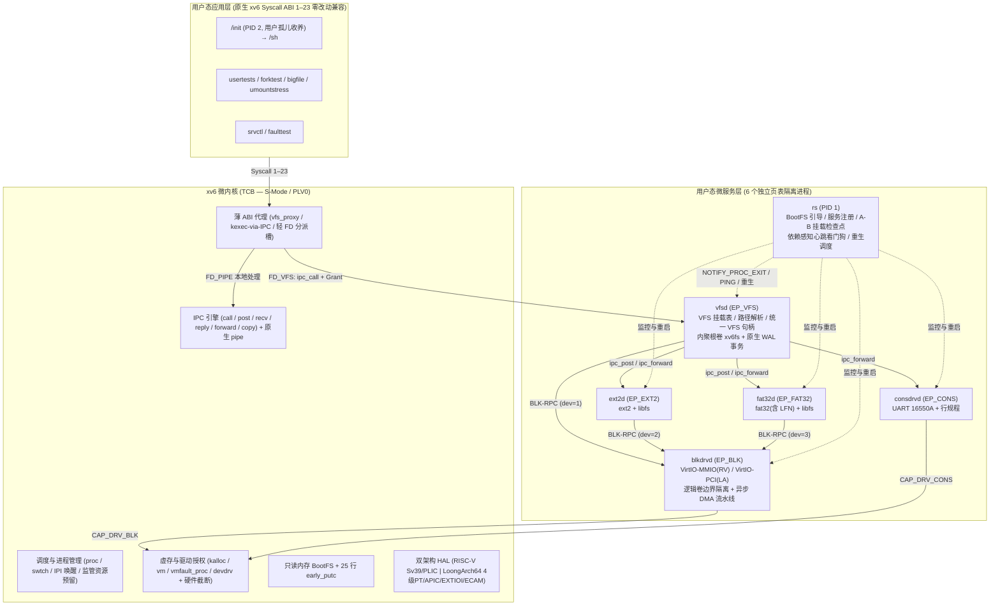

# xv6 双架构微内核架构设计

本文档定义面向 RISC-V 与 LoongArch64 双架构、支持 xv6fs / ext2 / FAT32 三种文件系统的 xv6 微内核重构架构，覆盖内核边界、IPC 与能力授权、FD 与文件系统分层、用户态设备驱动、双架构硬件适配及故障隔离与恢复契约。

---

## 一、总体架构与信任边界

### 1. 微内核与 6 服务拓扑（严格 DAG，无循环依赖）

系统将所有文件系统（VFS、xv6fs+WAL、ext2、FAT32）与设备驱动（VirtIO-MMIO / VirtIO-PCI、UART/Console）迁出内核至独立用户态地址空间；微内核仅保留调度、地址空间、陷阱与中断路由、IPC 引擎、原生纯内存管道（`pipe.c`）、薄系统调用代理与最小内存自举表（BootFS）。

为兼顾**最小 IPC 跳数**与**单卷独立故障隔离**，采用 **6 个用户态常驻服务进程**：
- **`vfsd` 内聚根卷 `xv6fs`（含原生 WAL 日志）**：根卷操作（占 `usertests` 95%+ 负载）缓存命中仅需 **1 次 IPC**，落盘最多 **2 次 IPC**（`App → vfsd → blkdrvd`）；
- **`ext2d` 与 `fat32d` 独立进程隔离**：各自独占用户页表、本地块缓存与磁盘格式实现，单卷崩溃绝不影响根卷与另一扩展卷；通过卷内多级路径查找与 `ipc_forward` 直通读写，热路径同样压缩至 **1 轮往返**。



### 2. 进程权限与故障隔离边界

BootFS 清单在构建期静态绑定每个服务的端点、逻辑卷与能力掩码至 `struct proc`，运行期不可伪造或提权：

| 服务名 | 角色 | `allowed_ep` | `allowed_dev` | 能力位 `caps` | 职责与隔离范围 |
| :--- | :--- | :--- | :--- | :--- | :--- |
| `rs` | PID 1 (`rsproc`) | `EP_RS (1)` | `0` | `CAP_SUPERVISOR` | 唯一可调 `spawn_bootmod`、读崩溃日志、使用预留进程槽与内存页；独占管理与回收 `PFLAG_SERVICE` 子进程 |
| `consdrvd` | 驱动服务 | `EP_CONS (2)` | `0` | `CAP_DRV_CONS` | 仅可映射 `UART0`、绑定 `UART0_IRQ`、触发内核 `procdump` |
| `blkdrvd` | 驱动服务 | `EP_BLK (3)` | `ALL_VOL` | `CAP_DRV_BLK` | 仅可映射 VirtIO MMIO/PCI、申请有界 DMA 页、绑定 `VIRTIO0_IRQ`；校验调用方逻辑卷权限与块区间 |
| `vfsd` | VFS + 根卷服务 | `EP_VFS (4)` | `ROOTDEV (1)` | `CAP_VFS \| CAP_FS` | 挂载表、路径解析、打开文件描述与共享偏移、根卷 `xv6fs` + WAL 事务；仅可访问 `[0, FSSIZE)` |
| `ext2d` | EXT2 卷服务 | `EP_EXT2 (5)` | `EXT2DEV (2)` | `CAP_FS` | 独立 EXT2 文件系统与本地块缓存；仅可访问 `[FSSIZE, FSSIZE+EXT2SIZE)` |
| `fat32d` | FAT32 卷服务 | `EP_FAT32 (6)` | `FAT32DEV (3)` | `CAP_FS` | 独立 FAT32（含 LFN）与本地块缓存；仅可访问 `[FAT32START, disk_blocks)` |
| `/init` 等 | 普通用户进程 | `0` | `0` | `0` | PID 2 `initproc` 运行未改动 `/init`（首次 `mknod("console")` 与普通用户孤儿收养） |

> **隔离边界声明**：CPU 页表隔离用户态服务的软件崩溃（非法访存、除零、栈溢出、越权调用、死循环）；无 IOMMU 的 QEMU 平台上，总线 DMA 越界不属于页表防护范围，由内核白名单 MMIO 与驱动退出前确定性硬件截断 DMA 保障物理页安全。

---

## 二、内存自举（BootFS）与启动时序

### 1. 只读内存 BootFS（零 `fs.img` 磁盘占用）
- 构建阶段将剥离调试符号的 6 个服务 ELF（`rs`, `consdrvd`, `blkdrvd`, `vfsd`, `ext2d`, `fat32d`，总计约 200–300 KiB）通过 `.incbin` 嵌入内核 `.rodata`（不占用 `fs.img` 的 `FSSIZE=2000` 磁盘空间；在 LoongArch64 上链接于 `0x9000000000200000`，亦不消耗 `0x9000000090000000` 起的 128 MiB `kalloc` 物理内存池）。
- 服务重启直接从只读内存 BootFS 装载，彻底消除块驱动或根卷崩溃时的自举循环依赖。

```c
struct bootmod {
  const char  *name;
  const uchar *data;
  uint64       size;
  uint32       caps;
  int          allowed_ep;
  uint         allowed_dev;
};
```

### 2. 有序启动与进程树分离
1. 内核初始化物理页、页表、进程表、陷阱、双架构 HAL 与 IPC 引擎，直接从 BootFS 加载 **PID 1 `rs`**（移除内核 `binit`/`iinit`/`fileinit`/`vfsinit`/`hal_disk_init`/`fsinit`）。
2. `rs` 依次拉起 `consdrvd` → `blkdrvd` → `vfsd`（`vfsd` 启动时对 `ROOTDEV` 执行 `initlog` / `recover_from_log` / `ireclaim`，原样输出 `recovering` 与 `ireclaim`）→ `ext2d`、`fat32d`，等待各服务发送 `RS_MSG_READY`。
3. 核心服务全部就绪后，`rs` 调用 `spawn_user_init("/init")` 创建 **PID 2 `initproc`**（普通用户能力 `caps=0`，在 `vfsd` 中初始化 `cwd="/"`）。普通用户孤儿由内核 `reparent()` 交给 `initproc`，服务子进程由 `rs` 独立回收，普通 Shell 的 `wait()` 不可见服务退出。

---

## 三、IPC 引擎、并发模型与能力授权拷贝

### 1. 精确 64 字节消息帧 ABI（双架构编译期校验）

```c
#define IPC_MSG_INLINE 24

struct ipc_msg {
  uint32 op;                         //  0..3  操作码 / IPC_OP_NOTIFY / IPC_OP_REPLY
  int32  status;                     //  4..7  返回值或负错误码
  uint32 token;                      //  8..11 令牌（高16位 generation，低16位 req 槽位）
  uint32 flags;                      // 12..15 IPC_F_DELEGATE / IPC_F_ASYNC
  uint64 arg0;                       // 16..23 通用参数 0（handle / dev / inum / notify_bits）
  uint64 arg1;                       // 24..31 通用参数 1（offset / mode / blkno / tag）
  uint64 arg2;                       // 32..39 通用参数 2（len / parent_inum / req_id）
  char   inline_data[IPC_MSG_INLINE];// 40..63 短文件名 / 参数 / stat 摘要
};

_Static_assert(sizeof(struct ipc_msg) == 64, "ipc_msg must be 64 bytes");
```

### 2. 六个 IPC 原语与跨核唤醒（私有系统调用号 24–29）

所有 IPC 结构体静态内嵌于 `struct proc` 或固定容量服务槽位，**热路径零 `kalloc()`**，彻底免疫内存耗尽死锁。每个端点持独立细粒度自旋锁（避免 SMP 全局锁竞争）。

| 原语 | 签名 | 语义与并发保证 |
| :--- | :--- | :--- |
| `ipc_bind` | `int ipc_bind(int ep_id)` | 校验 `p->allowed_ep == ep_id`；递增 `ep->epoch`，置 `active=1`，唤醒等待该端点就绪的调用方 |
| `ipc_call` | `int ipc_call(int ep_id, struct ipc_msg *m, uint64 va, uint64 len, int perm)` | 客户端同步 RPC：使用 `p->req_slot`，绑定临时 `ipc_grant` 并设 `holder_pid = ep->owner_pid`；服务端死亡返回 `IPC_ERR_DEAD`，客户端被 `kill` 标记取消并返回 `IPC_ERR_INTR` |
| `ipc_post` | `int ipc_post(int ep_id, struct ipc_msg *m, uint32 orig_token, uint64 off, uint64 len, int perm)` | **服务间非阻塞下游投递**（供 `vfsd → ext2d/fat32d/blkdrvd` 与 `rs → PING`）：占用服务端预分配 `async_slots[]` 槽位，不阻塞发送方；下游应答以 `IPC_OP_REPLY` 投回原服务的接收队列。若 `orig_token != 0`，将原客户端授权**按收窄的 `[off, len)` 与 `perm` 委托给下游 `holder_pid`** |
| `ipc_recv` | `int ipc_recv(int ep_id, struct ipc_msg *out)` | 服务端统一事件入口：按优先级返回 (1) 非零 `notify_bits`（`IPC_OP_NOTIFY`），(2) 下游异步应答（`IPC_OP_REPLY`），(3) 新客户端请求；全空则睡眠 |
| `ipc_reply` | `int ipc_reply(uint32 token, struct ipc_msg *reply)` | 校验 `generation` 与 `req->holder_pid == myproc()->pid`；吊销授权（等待 `in_use==0`）并唤醒客户端或回投 `IPC_OP_REPLY`；迟到/已取消令牌静默丢弃 |
| `ipc_forward` | `int ipc_forward(uint32 token, int target_ep, struct ipc_msg *new_msg)` | 校验 `holder_pid` 后，原子将原 `token` 及其授权移交至 `target_ep`，原服务立即可继续 `ipc_recv`（用于 `vfsd → consdrvd` 及已解析的 `ext2d`/`fat32d` 直通读写） |

- **调度加速与跨核 IPI 唤醒**：`ipc_call` / `ipc_post` / `ipc_reply` 唤醒对端进程时，优先设置本核调度提示 `next_hint` 实现就地切换；若目标进程适宜在空闲副核执行或唤醒处于 `idle` 的核，触发轻量级核间 IPI，消除长时钟周期带来的跨核唤醒停顿。

### 3. 能力授权跨空间拷贝（`ipc_copy`，系统调用号 30）
- **签名**：`int ipc_copy(uint32 token, int dir, uint64 offset, uint64 srv_va, uint64 len)`
- **安全门控**：
  1. 校验 `token` 处于活跃在途态且 `req->holder_pid == myproc()->pid`；
  2. 原子递增 `grant->in_use++`，确保客户端并发取消或退出时等待拷贝结束再释放页表；
  3. 校验无溢出边界 `offset <= grant->len && len <= grant->len - offset` 与方向权限（`GRANT_READ` / `GRANT_WRITE`）；
  4. 按 4 KiB 分片跨页表搬运：用户缓冲调用显式绑定目标进程的 `copyin_proc(grant->owner, ...)` / `copyout_proc(grant->owner, ...)`（内部 `vmfault_proc(grant->owner, ...)` 正确处理 `sbrk` 懒分配与只读代码段保护，且 EOF 0 字节读不触发多余缺页或权限误报）；内核缓冲 `GRANT_KERNEL_BUF` 仅供 `kexec()` 加载 ELF 至新页表使用；
  5. 完成后 `grant->in_use--`，唤醒等待撤销的退出路径。

### 4. 无锁死 `kfork` 握手与监管资源预留
- **`kfork()` 锁序**：`allocproc()` 分配 `np`（`state = USED`）并完成 `uvmcopy` → **先 `release(&np->lock)`** → 对非 `PFLAG_SERVICE` 进程发起**单次批量原子 `VFS_OP_FORK_BATCH`**（携带父进程所有活跃 `FD_VFS` 句柄与 `cwd`）→ 失败则干净回收 `np`，成功再挂接 `parent` 并置 `RUNNABLE`。全程无持自旋锁睡眠，且杜绝部分句柄复制失败导致的泄漏。
- **双资源保底**：
  - 进程表 `NPROC = 72`（普通用户上限仍保持 64，保留 8 槽专供常驻服务与 `CAP_SUPERVISOR` 重生）；
  - 物理页保底 `MIN_SVC_PAGES = 48`（192 KiB）：空闲页 `<= MIN_SVC_PAGES` 时仅允许 `CAP_SUPERVISOR` 与内核关键路径分配，确保 `mem` / `sbrkfail` / `forkforkfork` 极限压测下 `rs` 仍能完整完成服务重启。

---

## 四、FD 统一分派、Pipe 归属与文件系统设计

### 1. 内核轻 FD 分派槽 + 原生 `pipe`（杜绝管道在 `vfsd` 内背压死锁）
管道是纯内存进程间通信原语，无磁盘与命名空间状态；将管道塞入单线程 `vfsd` 既会增加非阻塞等待队列复杂度，又会在多进程写满管道时挤占 `vfsd` 请求槽引发背压死锁。因此：
- **微内核保留原 130 行 `kernel/pipe.c`**，并维护极简的每进程 16 槽分派表 `p->ofile[NOFILE]`，仅区分两类：
  - `FD_PIPE`：指向内核 `struct pipe *`，`pipe`/`read`/`write`/`dup`/`close` 全程内核直通，零 IPC 开销、零死锁风险；
  - `FD_VFS`：保存 `(vfs_handle, vfs_epoch)`，统一覆盖普通文件、目录以及 `/console` 设备节点（`FD_DEVICE`）。
- **`/console` 语义完整保留**：`/console` 经 `vfsd` 打开并保留底层 inode 引用，`fstat(0)` 正常返回设备 inode 元数据，`unlink("console")` 遵循延迟释放；`read`/`write` 由 `vfsd` 校验权限后经 `ipc_forward(token, EP_CONS)` 零阻塞转交 `consdrvd`。
- **`kexec()` 解耦**：内核通过 `VFS_OP_EXEC_OPEN`（保留无 `'/'` 相对路径回退 `"/" + path` 规则）、`VFS_OP_EXEC_READ`（携带 `GRANT_KERNEL_BUF` 直接填充新页表物理页）与 `VFS_OP_EXEC_CLOSE` 完成 ELF 装载，彻底移除 `exec.c` 中的文件系统依赖。

### 2. 统一 FS-RPC 协议与 `libfs` 无损迁移层
`ext2.c`（1,216 LOC）与 `fat32.c`（1,183 LOC）通过约 250 LOC 的用户态适配器 **`servers/libfs/`** 原样迁出内核，复用既有磁盘格式实现；`fs.c + log.c` 直接内聚在用户态 `vfsd` 中：
- **块缓存与 WAL 事务纪律**：
  - `vfsd` 根卷 `xv6fs`：**严格保留原生 `log.c` WAL 顺序**（`begin_op` → `log_write` pin 块 → `end_op` 依次执行 `write_log` → `write_head` → `install_trans` → `bunpin`）及按 `MAXOPBLOCKS` 的写分片边界，禁止普通脏块提前落盘破坏恢复语义；
  - `ext2d` / `fat32d`：各自维护本地 LRU 读缓存，大幅削减向 `blkdrvd` 的跨进程 IPC，`bwrite` 同步透写 `blkdrvd`；`unmount` 或下层 `blkdrvd` 纪元变更时整卷失效缓存。
- **11-Opcode 卷后端协议**（`vfsd → ext2d / fat32d`）：
  - `MOUNT`, `UMOUNT`, `LOOKUP_PATH`（支持单次 IPC 解析卷内多级无挂载点子路径，避免逐级往返）, `CREATE`, `UNLINK`, `LINK`, `READ`, `WRITE`, `STAT`, `TRUNC`, `RELEASE`；
  - **严格单向依赖**：嵌套挂载点的 `unlink` 占用检查前置在 `vfsd` 中完成（查表并预留目录项至后端回复），禁止 `ext2d`/`fat32d` 回调 `vfsd`；
  - **跨进程引用协同**：`LOOKUP_PATH`/`CREATE`/`MOUNT` 在后端持有 `ip->ref`，仅当 `vfsd` 的 vnode 引用归零时发送 `FS_OP_RELEASE`，完整支持 `unlinkopen` 延迟回收（同步修正基线 `BUG-18`：FAT32 `unlink` 时清除 `addrs[1]` 防止后续写覆盖已复用目录槽）；卷重启时 `vfsd` 一次性清空旧纪元引用，杜绝僵尸引用阻断卸载。

---

## 五、用户态驱动与双架构（RISC-V / LoongArch64）硬件适配

### 1. 受限驱动原语（私有系统调用号 31–33）
- **`dev_map(int dev_id, uint64 *out_va, struct dev_info *out_info)`**：按能力白名单将设备 MMIO 映射至用户高地址区 `DEV_MMIO_BASE`（位于 `p->sz` 之上、`TRAPFRAME` 之下），记录于 `p->devmaps[]`（类型 `DEVMAP_MMIO`），进程退出时 `do_free=0` 卸载，不触碰 `kfree()`。
- **`dma_alloc(int npages, uint64 *user_va, uint64 *dma_pa)`**：仅 `CAP_DRV_BLK` 可调（上限 16 页），映射至 `DEV_DMA_BASE`（类型 `DEVMAP_DMA`），返回总线物理地址（LoongArch64 自动剥离 `DMWIN_MASK`）。
- **`irq_ctrl(int op, int irq)`**：`IRQ_BIND` 绑定中断通知至驱动端点；`IRQ_ACK` 完成中断控制器应答并重开中断线。

### 2. 驱动退出两段式 DMA 硬件截断（解决动态 PCI BAR 未知问题）
当 `blkdrvd` 正常或异常崩溃进入内核 `kexit()` → `devdrv_cleanup(p)` 时，严格按以下顺序执行：
1. **切断入口并屏蔽中断**：置 `EP_BLK.active = 0`、`epoch++`、唤醒并终止所有在途块请求；屏蔽并解绑 `VIRTIO0_IRQ`；
2. **第一段 · 总线层无条件截断 DMA（不依赖用户态动态 BAR）**：
   - **LoongArch64**：内核在启动探测期即已知 VirtIO-BLK 的静态 **PCI ECAM 配置空间地址（`PCI_ECAM + (dev << 15)`）**；退场时直接通过 ECAM 清除 `PCI_COMMAND` 中的 **`PCI_COMMAND_MASTER`（bit 2）**，立即在 PCI 总线层物理截断一切未完成 DMA；
   - **RISC-V**：直接向固定地址 `VIRTIO0 + VIRTIO_MMIO_STATUS` 写 `0`；
3. **第二段 · 设备状态机复位确认与页回收**：
   - 若 LoongArch64 的 PCI BAR `common_cfg` 经校验有效，再写 `device_status = 0` 并读回确认 `0`（RISC-V 读回 `VIRTIO_MMIO_STATUS == 0`）；
   - 确认停机后卸载 `DEVMAP_MMIO`（`do_free=0`）并安全释放 `DEVMAP_DMA`（`do_free=1`）；若超时未确认，则仅撤映射、**将 DMA 页永久移入隔离链表绝不 `kfree`**，并报告设备离线。

### 3. LoongArch64 四项底层硬件隐患的架构级根治

| 硬件问题 | 基线根因 | 架构级根治方案 |
| :--- | :--- | :--- |
| **1. 副核启动即死锁** | `entry.S` 将 `TLBRENTRY` 置 `0`；`kvminithart()` 漏写 `PGDL`/`PWCL`/`PWCH`；`trapinithart()` 为空漏写 `EENTRY`/`TLBRENTRY`/`MERRENTRY`/`ECFG`/`TCFG`，副核调度即跳 `0x0` 并死持 `p->lock` | 保存全局 `kernel_pagetable`，补齐副核 `kvminithart()`（写 `PGDL`/`PWCL`/`PWCH` + `tlbinit()`）与 `trapinithart()`（写 `ECFG`/`TCFG`/`EENTRY`/`TLBRENTRY`/`MERRENTRY` + 启用 IPI 向量）；同时将 LoongArch64 `trap.c` 中的 `p->killed` 访问统一改为加锁 `killed(p)`/`setkilled(p)` |
| **2. 167.8ms 时钟卡顿与副核 `idle 0` 睡死** | `tcfg = 0x1000000UL` 在 100MHz 计数器下周期达 167.8ms，且无核间 IPI 唤醒 `idle 0` 副核，导致跨核 IPC 延迟极高 | 缩短龙芯 `TCFG` 周期至 ~10ms（同时按比例校准逻辑 `ticks` 兼容 `pause` 时长）；为双架构引入核间 **IPI 唤醒**（龙芯 IOCSR IPI / RISC-V 软中断），在 `wakeup()` 与 IPC 唤醒时立即唤醒处于 `idle 0`/`wfi` 的副核，叠加本核 `next_hint` 直切 |
| **3. 串口与磁盘双双吞中断** | 龙芯 UART 为边沿触发（`LS7A_INT_EDGE_REG`），VirtIO PCI 为电平 INTx，两者在 ack 窗口均可能丢中断导致驱动永久沉睡 | `consdrvd` 与 `blkdrvd` **双驱动**统一实施“排空队列 → `IRQ_ACK` → 复检硬件状态位（UART `LSR_RX_READY`/`LSR_TX_IDLE` 与 VirtIO `used_idx != used->idx`）”；同时内核时钟中断在存在在途块请求或串口未完成 TX 时周期投递轻量 `NOTIFY_WATCHDOG` 双兜底 |
| **4. MMIO 缓存属性、非页对齐与 TLB 抖动** | `UART0 (0x1fe001e0)` 偏移 `0x1e0`；MMIO 须 `MAT=0` 强序非缓存；`uservec`/`userret` 每次全量 `invtlb` 放大多跳 IPC 成本 | `dev_map` 按 `PGROUNDDOWN(pa)` 映射并清除 `PTE_MAT` 返回页内偏移；通过“6 服务内聚根卷 + 分域 LRU 缓存 + 4 KiB 读写分片 + `FS_OP_LOOKUP_PATH` + `ipc_forward`”将常规操作压至 1 跳 IPC；必要时按 `pid` 启用轻量 ASID 避免全量 `invtlb` |

---

## 六、故障模型、诚实恢复契约与验收标准

### 1. 请求四态机与诚实故障契约
所有跨服务请求划分为四态：`UNSENT`（目标端点已死未入队）→ `DISPATCHED`（已入队/执行中）→ `COMMITTED`（已落盘或已写日志提交头）→ `REPLIED`（已返回调用方）。

- **允许透明重试的边界**：仅限 `UNSENT` 状态，或**无副作用纯读操作**（`BLK_READ`、`FS_READ`、`FS_STAT`）。
- **禁止静默重放的边界**：
  - `ext2d` / `fat32d` 在**写操作或元数据扩展中途**崩溃，或 `blkdrvd` 在**写完成确认前**崩溃：因两卷无通用磁盘日志，**绝不自动重试写**，在途调用有界返回 `-1`，对应卷标记 `NEEDS_CHECK` 并记录代次与未确认操作，**未受影响的其余卷在设备恢复后继续运行**；
  - `vfsd` 自身崩溃后由 `rs` 从 **A/B 双缓冲挂载检查点**（仅保存 `NMOUNT=8` 确认挂载条目 + `seq` + CRC32，单侧写坏自动回退另一侧）依父子顺序重建挂载拓扑，旧 `FD_VFS` 句柄按 `vfs_epoch` 明确失效返回 `-1`（`close()` 仍合法释放本地槽），绝不按路径静默重开导致旧 FD 误绑同名新文件。

### 2. 依赖感知心跳看门狗（覆盖 Crash-Stop 与 Hang/Livelock）
`rs` 周期以非阻塞 `ipc_post(ep, RS_OP_PING)` 探活各服务，服务应答自身单调 `progress_cnt` 与当前等待的下游端点 `waiting_dep_ep`。仅当某服务连续 2 个周期无应答 **且** 其依赖的下游端点健康活跃时，`rs` 才判定该服务进入死循环/卡死并主动 `kill(pid)` 触发重生，避免误杀等待合法慢盘 I/O 的健康服务。

### 3. 故障隔离与可恢复验收矩阵（`tests/fault_isolation/`，双架构）

> xv6 两架构用户态 `.text` 从 VA `0x0` 起可读可执行，单纯读空指针不会触发缺页异常；所有页错误故障注入均使用确定性**非法写**（写只读 VA `0x0` 或未映射高地址 `0xdeadbeef000`）或命名检查点受控退出。

| 测例 | 故障目标与注入点 | 隔离性可观测判据 | 自愈性可观测判据 |
| :--- | :--- | :--- | :--- |
| **F1** | `ext2d` 非法写触发真实页错误，连续 5 轮 | 记录原 PID、`scause`/`estat` 与新代次；后台并发读写 `/` 与 `/fat` **逐笔统计成功完成数（持续增长）与最大停顿 ticks**；内核无 `panic`/`kerneltrap` | `ext2d` 5 次全部自动重生并挂回 `/mnt`，新 `open` 校验故障前已关闭文件内容一致 |
| **F2** | `fat32d` 分别在 (a) 读中途检查点退出；(b) 写扩展中途退出 | 同一内核 boot ID 下，Shell PID 与已打开的 `ext2` FD 持续有效并完成读取 | (a) 旧 FAT32 FD 有界返回 `-1`，新 `open` 校验一致且不误绑同名新文件；(b) 写中途标 `NEEDS_CHECK` 有界报错，不伪造写成功 |
| **F3** | `blkdrvd` 分别在 (a) 三卷并发读期间页错误退出；(b) 写确认前退出 | 按序核对：**ECAM 关 `PCI_COMMAND_MASTER` / 写 `STATUS=0` 确认停机 → 旧 DMA 页回收 → 新队列就绪**；`consdrvd` 与内存任务持续运行 | (a) 三卷均恢复可读并校验 `fs.img` 字节；(b) 未受影响卷继续，受影响无日志卷标记待检查 |
| **F4** | `vfsd` 根卷在 WAL `write_head` 前／后退出 + 独立镜像跑 `test-xv6.py crash` | 同一内核 boot ID 存活；无 `panic` | 提交前退出读到旧一致态，提交后退出读到新一致态；双架构 `log`/`forphan`/`dorphan` 正常捕获 `recovering`/`ireclaim` |
| **F5** | `consdrvd` 在存在阻塞 `read(0)` 期间退出 | 阻塞读在有界期限内返回 `-1`；后台磁盘写持续完成 | 重生并重绑 `UART0_IRQ` 后，完整输入新命令并读出正确输出 |
| **F6** | `vfsd` 自身退出（正常 A/B 检查点与单侧损坏双子用例） | 底层 `blkdrvd`/`consdrvd`/`ext2d`/`fat32d` PID 与代次不变；独立 `FD_PIPE` 不受影响 | A/B 检查点自动重建多级挂载拓扑；旧 `FD_VFS` 返回 `-1`；新命令与新 `open` 全面恢复 |
| **F7** | 沙箱安全与假死三项独立判定：(a) `ext2d` 越权调 `dev_map`/越界读 `FAT32DEV`/伪造非持有 `token`；(b) 合法慢盘延迟；(c) 死循环卡死 | (a) 越权调用全部被拒返回 `-1`；(b) 慢盘期间 **0 误杀**；(c) 卡死不阻塞其他卷 | (c) `rs` 看门狗超时强杀并重生卡死服务，新请求恢复正常 |

---

## 七、代码预算、验收与演示口径

### 1. 代码瘦身与内存预算
- **内核瘦身**：总代码从基线 `11,471 LOC` 降至约 **6,000–6,300 LOC**（架构无关内核缩减 **> 60%**）；微内核净新增代码控制在 **~850 LOC** 内，用户态净新增基础设施控制在 **~1,100 LOC** 内。最终通过链接 map、用户 ELF 与运行时进程表三方核对确认内核零残留文件系统与常规驱动符号。
- **内存占用**：BootFS + 6 常驻服务 + 保底页总计控制在 **< 5 MiB**，保障 `sbrkmuch` / `sbrkfail`（100 MiB / 128 MiB）测试余量；报告单列内核 `text/data/bss`、BootFS、服务常驻页与预留页。

### 2. 全量验证与性能对照口径
- **基线前置修正**：重构前先修正 `baseline_debug.md` 中的基线与工具问题（`BUG-06` 龙芯锁竞争、`BUG-15` GCC 16 `fsblocks`、`BUG-16` runner 收尾 reject 漏判、`BUG-17` `pkill` 进程组隔离、`BUG-18` FAT32 `unlinkopen` 残余 `addrs[1]`、`BUG-19` `vfsbench` 字节校验及龙芯副核初始化缺陷）。
- **兼容性验收**：双架构通过 `make verify-all`（11 套扩展测试 + 完整 `usertests`）及独立镜像副本的 `test-xv6.py crash`；双架构连续 20 轮运行 `tests/fault_isolation/`（F1–F7）统计成功率、MTTR ticks、空闲页与僵尸数。
- **性能与对照基准**：宏内核与微内核在相同架构、CPU 数（`CPUS=3`）、工具链与镜像下各跑 5 次冷启动与固定负载，报告 `vfsbench` / `bigfile`（1 MiB 校验）中位数与区间、每 MiB 的 IPC 与块请求次数，并与 MINIX 3 进行架构对照。
- **双轨展示**：(1) 双架构原生 QEMU 串口实录脚本与 runner 日志；(2) 适配 [web/server/terminal-session.js](file:///home/gly/code/realproj/OS_proj7-dev/web/server/terminal-session.js#L76-L81) 支持 Linux 原生 `qemu-system-riscv64` / `qemu-system-loongarch64`（`CPUS=3`），升级现有 `web/` 控制台为实时微内核拓扑、IPC 调用链与一键故障自愈观测台。
